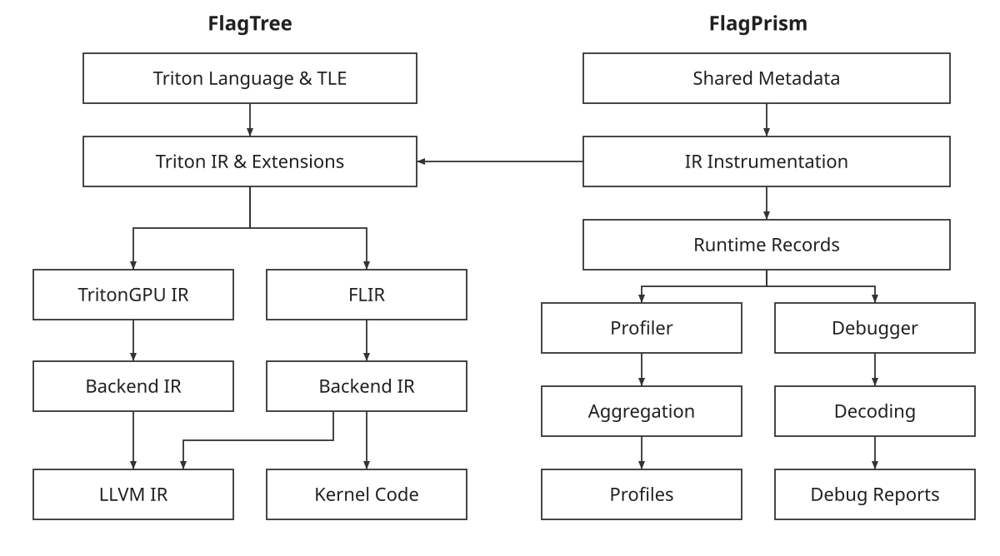
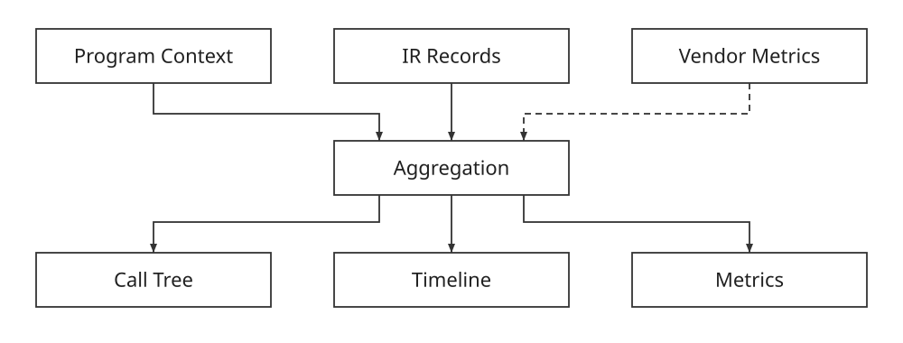
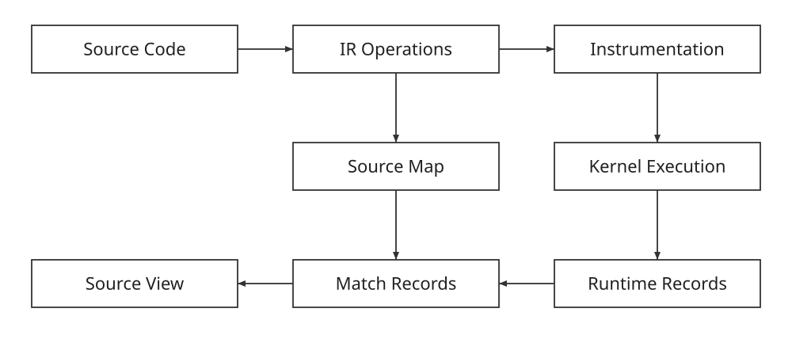
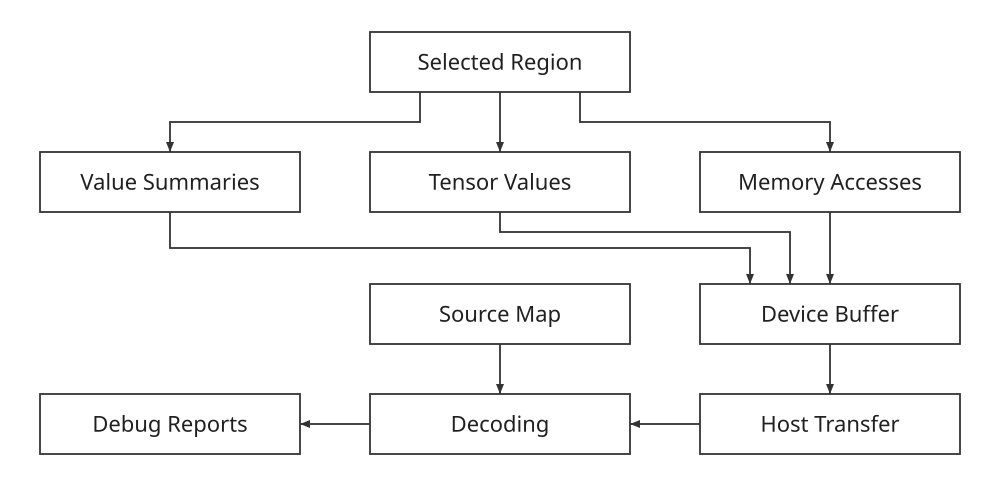

# FlagPrism Design

## Overview

FlagPrism provides profiling and debugging for Triton programs in the FlagTree
ecosystem. It connects the code developers write with the work performed by an
accelerator, helping them understand execution time, memory behavior, and
intermediate values inside kernels. The Profiler organizes execution data into
call trees, timelines, and performance metrics. The Debugger captures selected
values and memory accesses and presents them alongside the source statements
that produced them. Together, they provide a consistent way to investigate
performance and correctness across different accelerator backends.

To make profiling and debugging portable across architectures, FlagPrism inserts
observation code into Triton IR before device-specific compilation. FlagTree's
backends compile that code alongside the original computation. Backend adapters
handle memory allocation, data transfer, synchronization, and access to clocks
or hardware metrics.

The overall flow has two connected parts. Compilation produces an instrumented
kernel and metadata: descriptions of the source, operations, and observation
points. Execution produces records containing the collected data. Analysis
combines these descriptions and records, together with the host program's
execution context, to build profiles and debug reports.



*Figure 1. Compiler paths and the shared observation flow.*

The architecture separates recording on the device from interpretation on the
host. Different backends can implement different collection paths while keeping
the same basic workflow. Hardware profiling tools can provide additional data
alongside the compiler-based observations.

## Profiler Design

The Profiler helps developers move from a broad view of a workload to the work
inside an individual kernel. Its design connects three levels of information:
the surrounding program, kernel executions, and selected operations or regions
within a kernel.



*Figure 2. The dashed connection marks optional vendor metrics.*

### Connecting Program Context to Kernels

A kernel's name and duration are useful, but they do not explain why it ran.
The same kernel may be called from several parts of a model or repeated many
times with different inputs. The Profiler therefore records the context around
each launch, using Python call information or regions named by the developer.

This context forms a hierarchy. A model operation can contain several kernel
launches, and a kernel can contain finer observations. Keeping the launch context
with the collected data lets the report group repeated work without losing its
place in the program.

A profiling session controls when collection starts and stops and which sources
of information participate. At the end of the session, the Profiler collects
pending results and prepares the reports. Kernel launch tracking connects this
session lifecycle to the execution of individual kernels.

### Looking Inside a Kernel

Observing only kernel boundaries leaves its internal behavior hidden. To expose
that behavior, the compiler places recording code at selected IR operations or
around regions of interest. Depending on the collection mode and backend, the
records describe activity, memory accesses, or timing windows.

Consider this simplified fragment inside a Triton kernel:

```python
x = tl.load(x_ptr + offsets, mask=mask, other=0.0)
y = x + 1.0
tl.store(y_ptr + offsets, y, mask=mask)
```

The source describes a load, an addition, and a store. Its IR also contains the
address calculations and other operations needed to express that work. By
placing observations around selected operations, the Profiler can expose more
detail than a single duration for the entire kernel. Descriptions of memory
operations can also be combined with runtime records to estimate accessed bytes.

The collection path is chosen to match the information needed. Ascend and
Tianshu profiling reuse the Debugger's IR collection machinery with profiling
settings. The Profiler also has a scope-based instrumentation path, represented
internally by the Proton and ProtonGPU IR dialects, for supported GPU backends.
Both approaches turn selected regions of compiler IR into executable recording
code, although their implementation and available measurements differ.

### Connecting Source, IR, and Execution

The central challenge is retaining the meaning of an observation while the
compiler transforms the program. A source statement may produce several IR
operations, and those operations may later be split, combined, or reordered.
FlagPrism connects the stages by identifying observations and saving their
meaning separately from the runtime data.

During compilation, the collection machinery identifies the operations or
scopes being observed. For the operation-based path, it saves descriptions such
as the source location, statement, operation kind, and known type or shape.
Identifiers connect these descriptions to the corresponding observation points.
Each identifier is interpreted using the metadata for that compiled kernel.
Together, these saved descriptions form a source map.

The inserted recording code carries the identifiers as it is compiled into
device code. At execution time, it writes compact records containing those
identifiers and the requested measurements. The surrounding runtime keeps the
records associated with their kernel launch. Where the collection path supports
it, instance information distinguishes observations from different parallel
instances of the same kernel.

After execution, analysis looks up each observation in the saved descriptions.
This reconnects a measurement to an operation, a source statement, and the
program context in which the kernel ran.



*Figure 3. The source map connects runtime observations back to the program.*

For the addition in the example, a record refers to an observation associated
with `y = x + 1.0`. Analysis can display the measurement under that statement
without recovering its meaning from machine instructions. The address
calculation and memory access in the load statement can appear as separate
operations beneath the same source statement.

The result is a connected view from source, through compiler IR, to execution,
even as the form of the program changes. The observations describe work at the
chosen recording points. A timing window around instrumented work is not
necessarily the isolated hardware latency of one source operation. Compiler
scheduling, asynchronous device work, and the recording code itself affect that
window.

### Building Useful Profiles

The Profiler combines the collected observations into complementary views. A
call tree groups work by program context and helps identify expensive regions.
A timeline shows when recorded events occurred and how they relate in time.
Operation details help explain the work inside a kernel. The same execution can
therefore be explored at several levels without treating each view as an
unrelated report.

Vendor tools can extend these views with hardware information, such as memory
throughput or compute-unit activity. Adapters select supported measurements,
control or invoke the vendor tool, and import its results. Available execution
identifiers, names, and timing information help associate the imported data with
the relevant kernel executions.

The origin of each metric matters. Bytes estimated from IR memory operations
describe expected work; they are not a direct measurement of traffic reaching
device memory. Likewise, host timing, device timing, and vendor hardware
counters answer different questions. Reports should preserve those distinctions
and make unavailable or unmatched data visible.

## Debugger Design

The Debugger helps explain how a kernel arrived at its result. It uses the same
basic connection between source descriptions and runtime observations, with
collection focused on values and memory behavior. Developers inspect the
recorded state after execution and use it to narrow down where a computation
went wrong.



*Figure 4. Selected observations are buffered on the device and decoded on the host.*

### Choosing What to Observe

Collecting every intermediate tensor can produce far more data than is useful.
The Debugger therefore lets developers select regions inside a kernel and choose
the depth of collection. Region markers describe the part of the computation to
observe; configuration determines whether the report needs compact summaries or
more complete values.

This supports a practical investigation process. Start with summaries over a
suspect region, identify an operation whose output looks unexpected, and then
request more detail around that part of the computation. Smaller regions reduce
both the amount of data and the work needed to interpret it.

### Capturing Values and Memory Behavior

Numerical summaries provide a compact first view of intermediate tensors.
Statistics such as minimum, maximum, mean, and counts of non-finite values can
show a problem without transferring every element. When more detail is needed,
full-value collection captures supported tensors so their individual elements
can be inspected.

Memory observations add another perspective. A calculation may be correct for
the values it receives while those values came from unexpected addresses.
Address summaries describe the observed access range and active elements.
Supported full-address collection provides more detail. Access masks are part
of this interpretation: an element excluded by a mask should not be treated as
an active memory access.

Returning to the load-add-store example, suppose the output contains unexpected
values. The developer can first inspect the summary of `x`, then that of `y`.
If `x` is already wrong, the next step is to examine the load's addresses and
mask. If `x` looks correct but `y` does not, the addition becomes the focus.
Full tensor data can then help locate the affected elements. This follows the
kernel's data flow while keeping each observation tied to familiar source code.

### Moving Observations Back to the Host

Before an instrumented kernel runs, the runtime prepares device memory for its
records and any larger tensor payloads. The launch integration makes that
storage available to the kernel; the Debugger's dynamic collection path uses an
additional internal argument for this purpose. The user kernel's source-level
argument list does not need to expose the bookkeeping.

The recording code writes observations into the prepared buffers during
execution. Small records carry identifiers and summaries, while larger value
dumps use separate payload storage. Keeping detailed source descriptions on the
host avoids repeatedly writing the same text for every observation.

Once execution has completed and the data is safe to read, the runtime transfers
it to the host for decoding. The usual workflow exports after the kernel
finishes. Backend adapters handle device memory and synchronization, allowing
the reporting logic to work with a common interpretation of the collected data.

### Reconstructing a Readable View

Decoding gives the raw records meaning, but a useful debugging report also needs
to recover the developer's view of the program. The saved mappings associate
records with their operations and source statements. Known types, shapes, and
input/output relationships help explain where a value belongs.

The primary view groups information by source statement, so developers can
follow the computation in a familiar form. An operation-level view exposes
additional compiler detail, and tensor artifacts provide access to captured
elements. These views serve different levels of investigation while referring
to the same collected execution.

Some operations provide only static context, and some requested observations
may be unavailable. The report must preserve that distinction: a missing record
does not establish that an operation produced zero or never executed. Partial
collection, including buffer overflow, must also remain visible so that users
can decide whether to narrow the region or repeat the run with more capacity.
